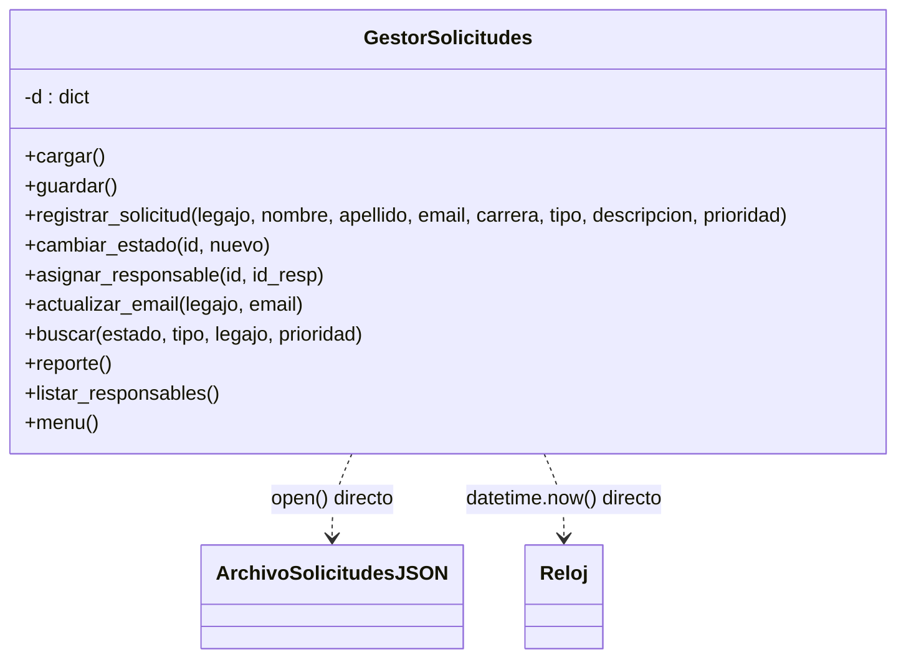
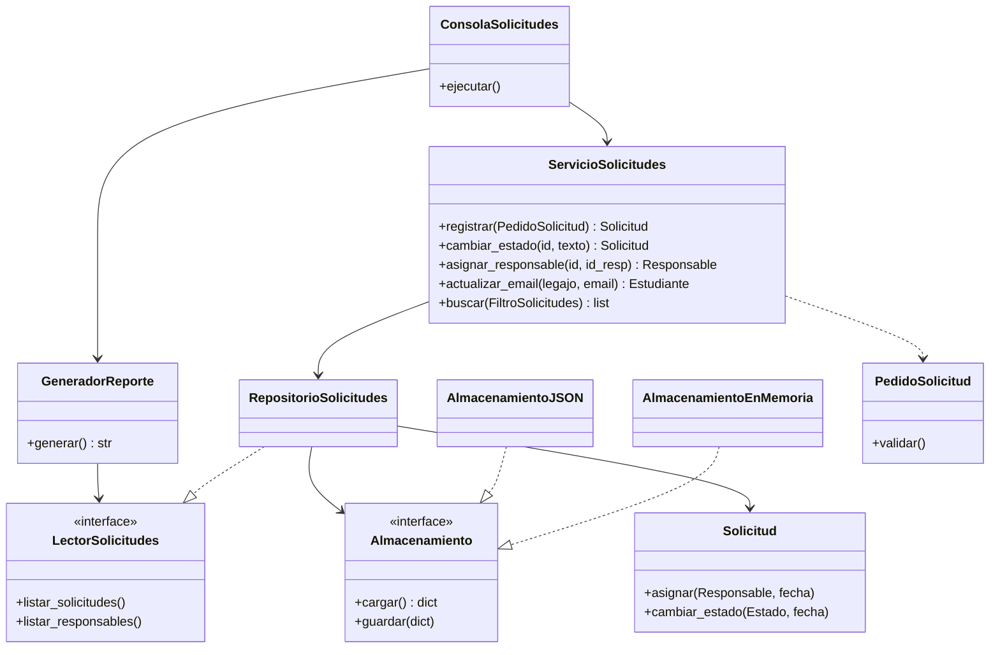

# Arquitectura — antes y después

## Antes (`estado-inicial`)

Una sola clase de 314 líneas lee el teclado, valida, aplica reglas, persiste e imprime.

## Después (`estado-refactorizado`)

## Módulos

| Módulo | Responsabilidad única | Depende de |
|---|---|---|
| `main.py` | Armar las dependencias y arrancar | todos (raíz de composición) |
| `solicitudes/cli.py` | Leer del teclado y mostrar resultados | servicio, reporte |
| `solicitudes/servicio.py` | Casos de uso | repositorio, pedidos, modelo |
| `solicitudes/reporte.py` | Construir el texto del reporte | `LectorSolicitudes` |
| `solicitudes/repositorio.py` | Traducir entidades ↔ documento | `Almacenamiento` |
| `solicitudes/almacenamiento.py` | Leer y escribir el documento | disco (solo `AlmacenamientoJSON`) |
| `solicitudes/pedidos.py` | Objetos de entrada y su validación | modelo, validaciones |
| `solicitudes/modelo.py` | Entidades, enumeraciones y reglas del dominio | errores |
| `solicitudes/validaciones.py` | Reglas de formato | — |
| `solicitudes/errores.py` | Jerarquía de errores de negocio | — |

Las dependencias apuntan hacia el dominio (`modelo.py`), que no depende de la consola ni del disco.
